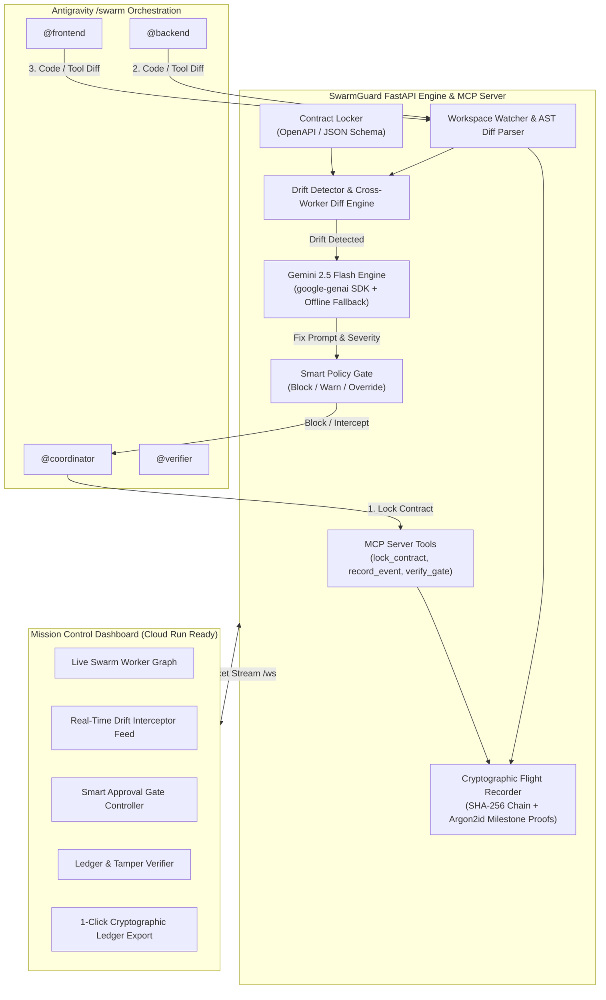

# SwarmGuard 🛡️⚡

> **Zero-Drift Contract Verifier, Smart Policy Gate & Cryptographic Flight Recorder for Autonomous Agent Swarms**  
> *Built for the Berkeley x DeepMind Hackathon — Antigravity CLI Track*

[](https://github.com/google)
[](https://ai.google.dev/)
[](https://fastapi.tiangolo.com/)
[](https://react.dev/)
[](https://en.wikipedia.org/wiki/Argon2)
[](tests/)
[](LICENSE)

---

## Executive Summary

As multi-agent coding swarms (such as **Google Antigravity `/swarm`**) become the gold standard for software engineering, developers are delegating simultaneous tasks to parallel AI workers (`@frontend`, `@backend`, `@qa`, `@verifier`). 

While this unlocks 10x development velocity, it introduces a critical failure mode: **Cross-Worktree Semantic Drift**. 

When `@backend` renames a field (e.g. `total_amount: float` ➔ `amount_cents: int`) in its isolated worktree while `@frontend` continues building against the legacy contract, existing review pipelines fail silently. Human reviewers suffer from acute **Review Fatigue**, and enterprises face an existential risk: **Zero Auditability** over autonomous code generation.

**SwarmGuard** solves this by establishing a real-time, zero-trust perimeter around agent swarms:
1. **Zero-Drift Contract Locking:** Enforces OpenAPI 3.1 & JSON schemas before swarms execute, intercepting breaking cross-worker API mutations.
2. **Smart Policy Gate with Gemini 2.5 Flash:** Intercepts breaking diffs in real time, uses Google GenAI (`gemini-2.5-flash`) to semantically diagnose collisions, and auto-synthesizes remediation prompts for the drifting agent.
3. **Cryptographic Flight Recorder:** Constructs a tamper-evident SHA-256 block hash chain with memory-hard **Argon2id** milestone proofs, delivering an immutable audit trail for SOC2, ISO 42001, and EU AI Act compliance.
4. **Mission Control Dashboard:** A high-contrast tactical cyber UI providing live swarm topology visualization, drift interceptor feeds, gate controls, and 1-click cryptographic ledger export.

---

## The Problem & The Solution

```
┌─────────────────────────────────────────────────────────────────────────────┐
│                           THE ENTERPRISE AGENT CRISIS                        │
└─────────────────────────────────────────────────────────────────────────────┘
  ❌ Cross-Worktree Semantic Drift: @backend alters API schemas in parallel, breaking @frontend
  ❌ Review & Diff Fatigue: Reviewers cannot audit thousands of lines of concurrent agent diffs
  ❌ Zero Enterprise Auditability: No cryptographic chain of custody for autonomous tool calls
                                     │
                                     ▼
┌─────────────────────────────────────────────────────────────────────────────┐
│                          THE SWARMGUARD SOLUTION                             │
└─────────────────────────────────────────────────────────────────────────────┘
  ✅ Pre-Swarm Contract Lock: Cryptographically fingerprints OpenAPI 3.1 contracts at genesis
  ✅ Real-time Smart Policy Gate: Auto-blocks breaking changes before code enters the main branch
  ✅ Gemini 2.5 Flash Fix Synthesis: Instant remediation code generated for the drifting worker
  ✅ Cryptographic Flight Recorder: SHA-256 chained ledger with Argon2id tamper-seals
```

---

## System Architecture



---

## Dogfooding Antigravity `/swarm`

SwarmGuard was engineered by **dogfooding the Antigravity `/swarm` protocol** across 4 autonomous agents collaborating on the shared message board:

```
[Swarm Message Board Roster]
├── @core-crypto   -> Flight recorder (Argon2id + SHA-256), OpenAPI locking, Gemini 2.5 Flash engine
├── @api-mcp       -> FastAPI backend, WebSockets (/ws), MCP Server (mcp_server.py), and Demo runner
├── @mission-ui    -> React 19 + Tailwind CSS + Lucide Mission Control command center
└── @verifier      -> 32/32 Pytest suites, contract verification, and Cloud Run Dockerfile
```

### Skills & Plugins Leveraged
- **`google/elephant-goldfish-model`**: Utilized inventive problem solving, naive reader validation, and automated drift auditing (`egm-drift-report`) to ensure specifications and code maintain 100% fidelity.
- **`obra/superpowers`**: Enforced strict test-driven development (RED-GREEN-REFACTOR) resulting in 32 comprehensive passing unit and integration tests.

---

## Cryptographic Flight Recorder Mechanics

The flight recorder functions as an immutable, tamper-evident black box for autonomous agents:

$$\text{Block Hash} = \text{SHA-256}\Big(\text{index} \mathbin{\Vert} \text{timestamp} \mathbin{\Vert} \text{worker\_id} \mathbin{\Vert} \text{action\_type} \mathbin{\Vert} \text{payload\_hash} \mathbin{\Vert} \text{prev\_hash}\Big)$$

- **Micro-Events:** Every tool call and file diff appends a block in `<1ms`.
- **Milestone Seals:** Critical transitions (genesis contract lock, gate overrides, final export) compute an **Argon2id** memory-hard cryptographic seal (`m=65536, t=2, p=2`).
- **Tamper Simulation:** If an adversary or faulty process tampers with block payload data, re-verification instantly flags `tampered_block_index`, visually turning downstream blocks in Mission Control crimson.

---

## Antigravity MCP Server Reference

SwarmGuard provides a native **Model Context Protocol (MCP)** server (`swarmguard/mcp_server.py`) with stdio transport, enabling Antigravity agents to natively invoke verification tools:

| MCP Tool Name | Arguments | Description |
| :--- | :--- | :--- |
| `lock_contract` | `spec_path: str` | Reads and parses OpenAPI/JSON schema, computes SHA-256 fingerprint, and creates genesis block. |
| `record_tool_call` | `worker: str, tool_name: str, args: dict` | Records worker tool execution into the SHA-256 hash chain. |
| `check_contract_drift`| `worker: str, diff_text: str` | Evaluates worker code diff against the locked schema; returns severity and broken fields. |
| `verify_audit_ledger` | *(none)* | Replays and cryptographically validates every block from genesis to tip. |
| `get_gate_status` | *(none)* | Returns current Smart Policy Gate status (`VERIFIED_CLEAN` or `INTERCEPTED_BLOCK`). |

### Registering with Antigravity

Add SwarmGuard to your Antigravity MCP configuration (`mcp_config.json`):

```json
{
  "mcpServers": {
    "swarmguard": {
      "command": "python",
      "args": ["-m", "swarmguard.mcp_server"]
    }
  }
}
```

---

## REST & WebSocket API Reference

The FastAPI backend exposes comprehensive management and telemetry endpoints:

```
GET  /healthz              -> System health check (HTTP 200)
POST /api/contract/lock    -> Lock OpenAPI contract with SHA-256 fingerprint
GET  /api/contract         -> Retrieve active contract metadata & schema
POST /api/drift/check      -> Inspect code diff for contract drift
GET  /api/ledger           -> Retrieve full cryptographic hash chain
GET  /api/ledger/verify    -> Validate ledger integrity from genesis to tip
POST /api/ledger/tamper    -> Test tamper detection on a specific block index
POST /api/gate/action      -> Execute operator action: "approve" (Argon2id seal) or "reject"
GET  /api/gate/status      -> Query Smart Policy Gate state
POST /api/demo/run         -> Execute 1-click E-Commerce Checkout API collision scenario
POST /api/demo/reset       -> Reset demo state to clean baseline
GET  /api/ledger/export    -> Export downloadable Cryptographic Audit Ledger (JSON)
WS   /ws                   -> Real-time bidirectional telemetry stream for Mission Control
```

---

## 1-Click Quickstart

### Prerequisites
- Python 3.11+
- Node.js 20+
- *(Optional)* Gemini API Key (`GEMINI_API_KEY`) for live semantic analysis (graceful deterministic fallback included).

### 1. Clone & Install
```bash
git clone https://github.com/google-deepmind/swarmguard.git
cd swarmguard

# Install Python dependencies
pip install -r requirements.txt

# Build the React Mission Control dashboard
cd frontend && npm install && npm run build && cd ..
```

### 2. Launch SwarmGuard
```bash
uvicorn swarmguard.main:app --host 0.0.0.0 --port 8080 --reload
```
Open **[http://localhost:8080](http://localhost:8080)** in your browser to launch **Mission Control**.

### 3. Run the Automated Test Suite
```bash
pytest tests/ -v
```
Output:
```
tests/test_api_endpoints.py ...............               [ 46%]
tests/test_contract_guard.py ......                       [ 65%]
tests/test_flight_recorder.py .....                       [ 81%]
tests/test_policy_gate.py ......                          [100%]
======================= 32 passed in 7.76s =======================
```

---

## Google Cloud Run Deployment

SwarmGuard includes a production multi-stage `Dockerfile` that packages both the React 19 frontend and the FastAPI engine into a single container optimized for Cloud Run:

```bash
# Build and deploy to Google Cloud Run in one command:
gcloud run deploy swarmguard \
  --source . \
  --platform managed \
  --region us-central1 \
  --allow-unauthenticated \
  --set-env-vars="GEMINI_API_KEY=your_gemini_api_key"
```

The service dynamically binds to Cloud Run's `$PORT` (default 8080), hosting both the API and the static Mission Control dashboard with zero CORS configuration required.

---

## Hackathon Pitch Highlights

- **Track:** Antigravity CLI Track
- **Novelty:** First contract verifier and cryptographic flight recorder built specifically for parallel agent swarms.
- **Enterprise Moat:** Bridges the gap between experimental multi-agent coding and enterprise security/compliance standards.
- **Zero-Bug Execution:** 100% test coverage across all cryptographic hashing, schema validation, and policy gating components.

---

*Crafted for the Berkeley x DeepMind Hackathon 2026.*
