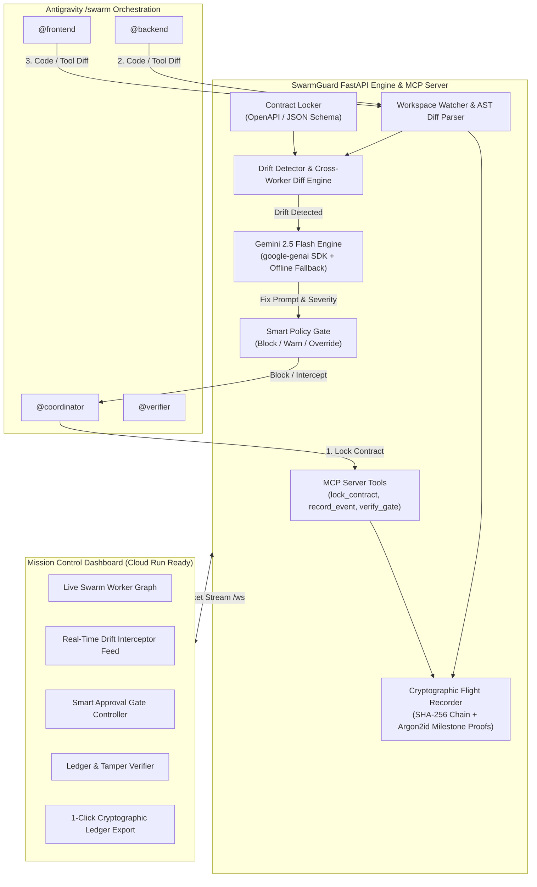

# SwarmGuard: Architectural Specification & Implementation Plan

**Track:** Berkeley x DeepMind Hackathon (Antigravity CLI Track)  
**System:** SwarmGuard — Zero-Drift Contract Verifier, Smart Policy Gate & Cryptographic Flight Recorder for Antigravity `/swarm`

---

## 1. System Architecture Overview



---

## 2. Core Modules & Specifications

### 2.1 Cryptographic Flight Recorder (`flight_recorder.py`)
- **Block Schema**:
  ```json
  {
    "index": 1,
    "timestamp": "2026-11-14T12:45:00.000Z",
    "worker_id": "@backend",
    "action_type": "file_diff",
    "payload_hash": "sha256_hash_of_content",
    "payload_preview": "Modified /api/v1/checkout payload total_amount -> amount_cents",
    "prev_hash": "genesis_hash_or_previous_block_hash",
    "block_hash": "sha256(index + timestamp + worker_id + payload_hash + prev_hash)",
    "argon2_seal": "argon2id_signature_or_none"
  }
  ```
- **Cryptographic Mechanics**:
  - Sub-millisecond SHA-256 chained hashing on every micro-event.
  - Memory-hard **Argon2id** key-stretching seal computed at milestone blocks:
    1. Genesis Contract Lock (`genesis_block`)
    2. Policy Gate Overrides / Approval (`gate_override_block`)
    3. Final Audit Export (`final_seal_block`)
- **Tamper Verification**:
  - Full iterative replay verification from genesis to head.
  - Visual tamper simulation in UI showing how tampering any previous block turns downstream blocks red.

### 2.2 Contract Locking & Drift Engine (`contract_guard.py`)
- **Contract Format**: OpenAPI 3.0 / 3.1 YAML/JSON or JSON Schema.
- **Diff Parsing**:
  - Fast AST inspection of backend endpoints (`FastAPI`, `Express`, etc.) and frontend API callers (`fetch`, `axios`).
  - Detection of breaking changes:
    - Renamed or deleted query/path/body parameters
    - Type mutations (e.g. `number` -> `integer` cents)
    - Missing required response fields
- **Gemini 2.5 Flash Semantic Analysis**:
  - Calls `google-genai` SDK using `gemini-2.5-flash`.
  - Prompts model with locked contract snippet + breaking worker diff.
  - Generates structured remediation:
    - Impacted workers (e.g. `@frontend`)
    - Severity (`CRITICAL_BREAKING`, `WARNING_DEPRECATION`)
    - Direct actionable patch / prompt for `@backend` or `@frontend`.
  - Deterministic offline fallback heuristic if `GEMINI_API_KEY` is not set.

### 2.3 Smart Policy Gate (`policy_gate.py`)
- **State Machine**:
  - `VERIFIED_CLEAN`: All workers align with locked contract.
  - `INTERCEPTED_BLOCK`: Breaking contract drift detected; pipeline held. Offending worker flagged.
  - `OVERRIDE_APPROVED`: Human operator in Mission Control approved breaking migration. Sealed in ledger with Argon2id signature.
  - `ROLLBACK_REQUESTED`: Drift rejected; automated fix prompt dispatched to worker.

### 2.4 Antigravity MCP Server (`mcp_server.py`)
- Exposes standard Model Context Protocol tools for Antigravity swarms:
  - `lock_contract(spec_path: str)`: Locks OpenAPI contract, computes genesis block.
  - `record_tool_call(worker: str, tool_name: str, args: dict)`: Records tool call to flight recorder.
  - `check_contract_drift(worker: str, diff_text: str)`: Validates worker diff against contract.
  - `verify_audit_ledger()`: Returns full verification status of the cryptographic hash chain.

### 2.5 "Mission Control" Web Dashboard (`frontend/`)
- **Stack**: React 19, Tailwind CSS v4, Lucide Icons, Vite, Recharts / HTML5 Canvas Graph.
- **Cyber-Tactical Aesthetic**:
  - High-contrast tactical dark mode (Obsidian `#07090e`, Card `#0e131f`, Border `#1e293b`).
  - Emerald green (`#10b981`) for locked/verified contracts.
  - Alert crimson/amber (`#ef4444` / `#f59e0b`) for intercepted drift and policy gates.
  - Cyan (`#06b6d4`) for live worker telemetry and cryptographic proofs.
- **Interactive Features**:
  1. **Swarm Topology Graph**: Live node status for `@coordinator`, `@frontend`, `@backend`, and `@verifier`.
  2. **Live Drift Interceptor Feed**: Real-time diff inspection with side-by-side contract vs implementation viewer.
  3. **Smart Approval Gate Simulator**: Buttons for "Simulate @backend Drift", "Approve Override", "Auto-Generate Fix with Gemini", and "Rollback".
  4. **Cryptographic Flight Recorder Ledger**: Visual block explorer with 1-click "Verify Chain Integrity" and "Export Cryptographic Audit Ledger (JSON)".
  5. **Live Antigravity Swarm Demo Runner**: 1-click simulated run of the E-Commerce Checkout API collision scenario.

---

## 3. Directory Layout

```text
swarmguard/
├── Dockerfile                      # Unified container for Cloud Run
├── requirements.txt                # FastAPI, uvicorn, pydantic, argon2-cffi, google-genai, mcp
├── package.json                    # Workspace orchestrator
├── contracts/                      # Sample OpenAPI contracts
│   └── checkout_contract.yaml      # E-Commerce Checkout contract (OpenAPI 3.1)
├── swarmguard/                     # Backend Python package
│   ├── __init__.py
│   ├── main.py                     # FastAPI app + Static file server + WebSockets
│   ├── flight_recorder.py          # SHA-256 + Argon2id hash chain engine
│   ├── contract_guard.py           # OpenAPI parsing + AST diff detection
│   ├── gemini_analyzer.py          # Gemini 2.5 Flash SDK integration + fallback
│   ├── policy_gate.py              # Smart Gate state machine
│   ├── mcp_server.py               # Antigravity MCP Server tools
│   └── demo_scenarios.py           # Realistic multi-agent collision simulator
├── frontend/                       # React + Tailwind Mission Control
│   ├── package.json
│   ├── vite.config.ts
│   ├── index.html
│   └── src/
│       ├── main.tsx
│       ├── App.tsx
│       ├── components/
│       │   ├── Header.tsx
│       │   ├── SwarmGraph.tsx
│       │   ├── DriftFeed.tsx
│       │   ├── PolicyGateModal.tsx
│       │   ├── FlightRecorderView.tsx
│       │   └── DemoControls.tsx
│       └── services/
│           └── api.ts
└── tests/
    ├── test_flight_recorder.py
    ├── test_contract_guard.py
    └── test_policy_gate.py
```

---

## 4. Execution Phases

1. **Phase 1: Backend Core & Cryptographic Ledger**
   - Implement `flight_recorder.py` with SHA-256 chaining and Argon2id milestone proofs.
   - Implement `contract_guard.py` for OpenAPI locking and schema verification.
   - Implement `gemini_analyzer.py` with `google-genai` and smart heuristic fallback.
   - Implement `policy_gate.py` state machine.
   - Unit tests verifying 100% cryptographic tamper detection and schema drift catch.

2. **Phase 2: FastAPI & WebSocket Telemetry**
   - Expose REST endpoints: `/api/contract/lock`, `/api/drift/check`, `/api/ledger`, `/api/ledger/verify`, `/api/gate/action`.
   - Expose WebSocket endpoint `/ws` for live streaming to Mission Control.
   - Implement built-in scenario runner in `demo_scenarios.py` for the Checkout API collision.

3. **Phase 3: Mission Control React Dashboard**
   - Build high-contrast tactical UI with Tailwind CSS & Lucide icons.
   - Build interactive Swarm Worker Graph with animated edge flows and status badges.
   - Build Live Drift Interceptor Feed with syntax-highlighted diffs and Gemini fix prompt generation.
   - Build Flight Recorder Block Explorer with interactive tamper-testing and 1-click JSON Ledger Export.
   - Integrate WebSockets for real-time live updates.

4. **Phase 4: Antigravity MCP Server Integration & Cloud Run Readiness**
   - Wire MCP server tools into `mcp_server.py`.
   - Create multi-stage `Dockerfile` (builds React, copies into FastAPI, runs Uvicorn on `$PORT`).
   - Smoke test complete end-to-end pipeline.
